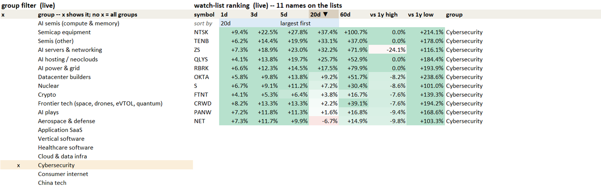
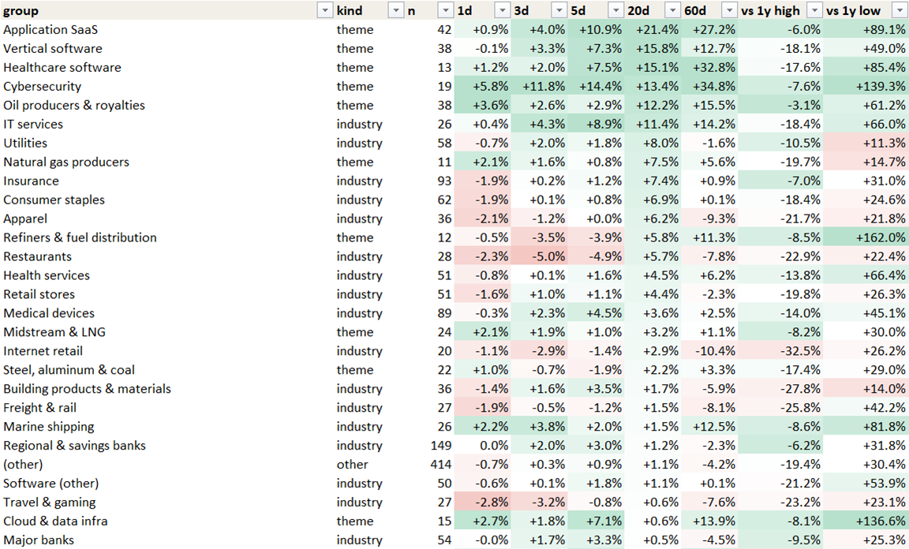

# The screener workbook, built by code

Every weekday night a Python script rebuilds one Excel workbook over the full US universe (~3,000 stocks) from the
bar store the pipelines keep current. It is a plain `.xlsx`, with no macros. Every number in it is a live formula, so
the screen can be re-cut by hand in Excel without re-running anything.

## What it's for

The workbook narrows about 3,000 stocks to a short list worth charting, and answers four questions for the next
session:

1. **Which stocks pass the screen today?** One live `PASS` column, with each filter's verdict beside it and a count of
   failed filters, so a near-miss is one sort away.
2. **Which list is each stock on?** Every passing stock sits on exactly one of the screener's lists (trend, pullback,
   contraction and so on), and the cross lists show which names just crossed their moving averages up or down.
3. **What changed since yesterday?** One tab per recent session, so who joined and who left each list is visible day
   by day.
4. **Which groups are leading?** A group ranking over 3, 5, 20 and 60 sessions and against each group's 1-year high
   and low, a rotation view of each group's share of names in an up-trend, and clusters of strong names that move
   together. SPY and QQQ sit in the ranking as benchmarks.

## How it's used

- **Pick a group with one mark.** An `x` next to a group in the picker filters every list, count and ranking to that
  group at once.
- **Read the ranked watch list** for that group, list by list.
- **Change the screen in place.** A filter switched off, or a threshold edited, on the controls sheet recomputes PASS,
  the counts and the lists immediately in Excel.

Charts and decisions happen in TradingView; the workbook's job is to make the short list complete and current.

## What it looks like

Two crops from the Oct 23, 2026 build, with the group filter set to Cybersecurity. The controls sheet and the
list names are not shown.

**The group picker and the ranked watch list.** The `x` beside Cybersecurity filters the book to that group. The
ranking sorts on any of its columns (here the 20-session return).



**The `groups` tab.** Each group's median name over 1 to 60 sessions and against its 1-year high and low, sorted
here on 20 sessions.



## What the workbook holds

| Tab | What it computes |
|---|---|
| one tab per recent session | every stock as a row; each filter's verdict as its own TRUE/FALSE column; a `PASS` column and a fail count that recompute live from the controls sheet; informational list columns that never enter PASS, so the AutoFilter can slice on them |
| `controls` | one toggle per filter and the editable thresholds, as named cells that every formula reads |
| `agg_` tabs | each list's members per session, day-to-day churn and a ranked watch list |
| `trend` | rotation by group: the share of each group's names in an up-trend, session by session |
| `groups` | the group ranking over 3 / 5 / 20 / 60 sessions and against each group's 1-year high and low, with SPY and QQQ |
| `clusters` | the strongest names that move together, found by correlation clustering (a map, not a buy list) |

## How it is computed

- **One library for every number.** The same Python functions compute each stock's metrics for the workbook and for
  the research studies, from broker prices with consolidated volume spliced in and unsettled bars dropped, with no
  look-ahead. A workbook cell and a backtest can never disagree.
- **Lists defined against each other.** Each list column is written against its neighbors' cells, so the lists
  partition their base exactly, even if one definition changes later.
- **Thresholds in one place.** Every threshold lives in one config file and on the controls sheet, never inside a
  formula.

The screen itself (the list definitions, the thresholds and the group membership tables) is the owner's method and is
not published. The builder and its library (about 4,100 lines) appear here only as the three short excerpts below.

## How it is verified

- **Against TradingView, number by number.** Every metric is compared with TradingView's own exported value for the
  same stock and day. Matching hit lists would prove nothing (the screen is meant to differ); "my EMA150 equals
  TradingView's to 0.01%" proves the formula. Where a definition is ambiguous, several candidate formulas are scored
  against TradingView's column and the best one is kept.
- **In Excel itself, headless.** A hidden Excel opens each new build, forces a full recalculation and reports every
  formula error.
- **Diff before install.** A new build goes to a test path first and is compared cell by cell with the previous
  workbook, against a list of the changes expected, before it replaces the live file. The nightly job also refuses to
  overwrite a workbook that is open in Excel.

## Excerpts

**1. The live PASS column**: no macros, so a toggle on the controls sheet is a named TRUE/FALSE cell, and each row's
PASS is an `AND` of "this toggle is off, or this filter's verdict holds". The guard on the anchored-VWAP leg is there
because Excel ranks text above every number, so a blank would otherwise pass.

```python
def gate(f, r):
    """One toggle's boolean leg for row r. Verdict columns hold booleans
    and are used as-is; the avwap toggle tests the live avwap_dist metric
    instead. ISNUMBER first: avwap_dist's formula renders a missing avwap
    as "", and text compares greater than any number in Excel, so a bare
    {L}{r}>0 would PASS exactly the rows that must fail."""
    c = L[f]
    if f == "avwap_dist":
        return f"IF(ISNUMBER({c}{r}),{c}{r}>0,FALSE)"
    return f"{c}{r}"

terms = [f"OR(NOT({nm}),{gate(f, r)})" for nm, f, _, _ in TOGGLES]
terms.append(f"OR(NOT(ON_xover),{since_l}{r}<=MAX_SINCE)")
ws.cell(r, tc["PASS"], "=AND(" + ",".join(terms) + ")")
fails = [f"IF({nm},IF({gate(f, r)},0,1),0)" for nm, f, _, _ in TOGGLES]
ws.cell(r, tc["n_fail"], "=" + "+".join(fails))
```

**2. Clustering the strong names** for the `clusters` tab: average-linkage clustering on the names' return
correlations (each name's returns centered on its own trading days), merging the most correlated pair of clusters
until no pair is correlated enough.

```python
def _avg_link(C, thr):
    """Average-linkage agglomeration on correlation matrix C: merge the most
    correlated pair of clusters while their average correlation is >= thr."""
    n = len(C)
    M = C.astype(float)
    np.fill_diagonal(M, -np.inf)
    size = np.ones(n)
    groups = [[i] for i in range(n)]
    while n:
        i, j = divmod(int(np.argmax(M)), n)
        if M[i, j] < thr:
            break
        new = (size[i] * M[i] + size[j] * M[j]) / (size[i] + size[j])
        M[i, :] = new
        M[:, i] = new
        M[i, i] = -np.inf
        M[j, :] = -np.inf
        M[:, j] = -np.inf
        size[i] += size[j]
        groups[i] += groups[j]
        groups[j] = []
    return [g for g in groups if g]
```

**3. Every formula error, found by Excel itself** (`recalc_excel.ps1`): a hidden Excel forces a full rebuild, then
asks each sheet for the formula cells that evaluate to an error. If Excel cannot open the file at all, that is a
failure too, not a silent "success".

```powershell
try {
    $wb = $xl.Workbooks.Open($full)
    $opened = $true
    $xl.CalculateFullRebuild()
    while ($xl.CalculationState -ne 0) { Start-Sleep -Milliseconds 300 }
    foreach ($ws in $wb.Worksheets) {
        try { $rng = $ws.UsedRange.SpecialCells(-4123, 16) } catch { $rng = $null }  # xlFormulas, xlErrors
        if ($rng -ne $null) { $errorsFound += $rng.Count }
    }
} finally {
    $xl.Quit()
}
if (-not $opened) {
    Write-Output "status: FAILED  |  Excel could not open $full"
    exit 2
}
```

## Built with

Python (pandas, openpyxl), Excel driven headless through COM for verification, TradingView exports as the reference,
and Windows Task Scheduler for the nightly run ([../2_pipelines/nightly/](../2_pipelines/nightly/README.md)). Every
change is built to a test path, diffed and re-checked before install.
