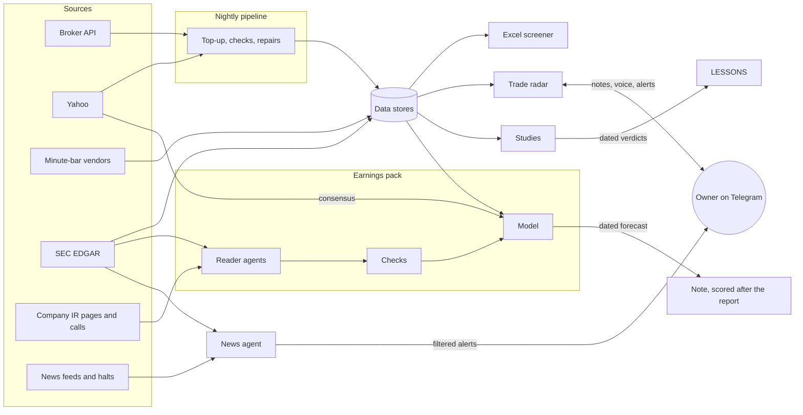

# AI Trading Research

**Data pipelines, market-monitoring agents and 47 backtested studies on US equities**

This is a one-person research and monitoring system for US stocks, built and run with AI. The owner designs it and
directs AI coding agents that build and review the code under fixed rules, and AI models work inside the products: they turn spoken notes into rules a
program can check, and they decide which headlines are worth an alert. The system runs unattended every trading day.

This repository shows how the system is built and how it is kept honest. The code appears only as short excerpts on
hand-written pages; the data, the keys and the screen's own definitions stay private.

## What this shows

- **Directing AI under rules.** Agents build, read and review, but plans are frozen before any result, every number
  an agent extracts is cited to a line and re-checked by a script, and a model's answer is forced into a schema that
  code checks again ([how the AI is used](#how-the-ai-is-used), [earnings pack](4_earnings/README.md)).
- **Running it unattended.** Six scheduled jobs on one PC, each with its own log and one summary message, and every
  lesson from running them written down ([jobs](1_agents/JOBS.md)).
- **Checking everything.** Each data source against another, the workbook against TradingView and against Excel
  itself, and each result against an independent rebuild ([nightly](2_pipelines/nightly/README.md),
  [workbook](3_workbook/README.md)).
- **Killing ideas honestly.** 47 studies, most of them killed, with what each one taught kept as a rule; the worked
  example shows a promising result traced to a look-ahead and killed ([study index](5_research/INDEX.md),
  [worked example](5_research/example_supply_chain_contagion/README.md)).
- **Keeping long work organized.** A profile every agent reads first, dated plan amendments, hand-off files and
  memory notes carry the work from one session to the next ([working with AI](6_working_with_ai/PROFILE.md)).

## At a glance

- **6 scheduled jobs** on one PC ([JOBS.md](1_agents/JOBS.md)): a nightly data pipeline, an always-on radar bot, a
  news agent that runs every minute, two forward-test logs and a weekly backup.
- **~3,000 US stocks refreshed every weekday night**, from the broker's API, Yahoo, two consolidated-minute vendors
  and SEC EDGAR, each source checked against another.
- **An Excel screener built entirely by code**: every number is a live formula, and every build is verified headlessly
  in Excel and diffed before it replaces the old one.
- **47 studies: 44 with a verdict, 3 still open.** Most ideas were killed. The lessons they paid for are rules every new
  study must follow.
- **One earnings pack in progress**: a single company's filings, release and call, worked end to end by reader agents
  under checks.

## How the parts fit

## The six cards

| # | Card | What it shows | Start here |
|---|---|---|---|
| 1 | **AI agents** | A Telegram radar that turns typed or spoken notes into rules through an AI router with a strict JSON schema, then checks them every night; a news agent with an AI judge; two forward-test logs that place no orders | [trade radar](1_agents/trade_radar/README.md) · [news](1_agents/trade_news/README.md) · [jobs](1_agents/JOBS.md) |
| 2 | **Data pipelines** | The unattended nightly run and how it fails safely; minute-bar downloaders checked source against source; SEC filings and a per-company fix for a filing-clock error | [nightly](2_pipelines/nightly/README.md) · [market data](2_pipelines/market_data/README.md) · [EDGAR](2_pipelines/edgar/README.md) |
| 3 | **Excel built by code** | A screener workbook of live formulas, rebuilt nightly, verified against TradingView number by number and by Excel itself | [workbook](3_workbook/README.md) |
| 4 | **Earnings research** | One company, one quarter: sources fingerprinted, reader agents with cited tables, a checker, a model and a dated forecast (in progress) | [earnings pack](4_earnings/README.md) |
| 5 | **Research rigor** | 47 studies with their question and verdict, the house rules they produced, and one worked example end to end | [study index](5_research/INDEX.md) · [lessons](5_research/LESSONS.md) · [worked example](5_research/example_supply_chain_contagion/README.md) |
| 6 | **Working with AI** | How long AI work is steered: a context file every agent reads first, dated plan amendments, hand-offs between sessions, memory notes | [profile](6_working_with_ai/PROFILE.md) · [amendments](6_working_with_ai/PLAN_AMENDMENTS.md) · [hand-off](6_working_with_ai/HANDOFF_example.md) · [memory](6_working_with_ai/memory_examples.md) |

## How the AI is used

**As the builder.** AI coding agents build and review the code, under rules that make their work checkable:

- **Plan before results.** A study's question, rules, controls and pass bar are written and frozen before any outcome
  is computed. A change after that is a dated amendment approved by the owner.
- **Independent checks.** Reviewer agents that did not write the code try to break each result. In the worked
  example, an independent rebuild from the plan alone caught a look-ahead flaw that three plan reviewers had approved.
- **Nothing installed blind.** A new workbook is built to a test path and diffed cell by cell before it replaces the
  live one. A study's test run never writes into its real output folder.
- **Propose, then change.** A question gets findings and options; files change only on an explicit go-ahead, scoped
  exactly.
- **Memory on disk.** Plans, hand-offs, logs and lessons are written for the next session, which is often a fresh model.

**Inside the products.** A command-line AI model runs locked down (read-only, no web search, no tools) with its answer
forced into a JSON schema: it is the radar's router and the news agent's judge, and code re-checks everything it
returns. Whisper runs locally on the GPU for voice notes and earnings calls.

## Excluded from repo

- Personal data and keys
- Full source files. About 1,100 lines of excerpts stand in for the code.

---

Shared for viewing; all rights reserved. Nothing here is investment advice.
